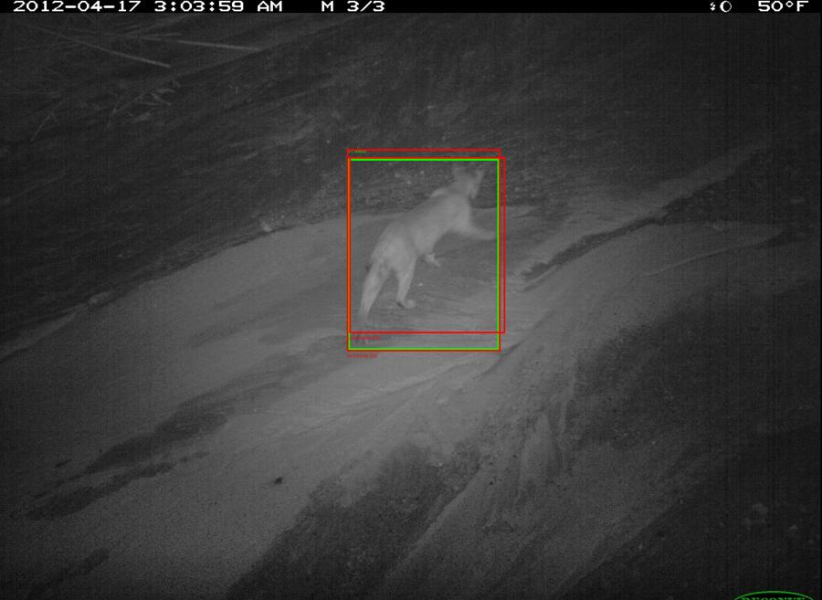
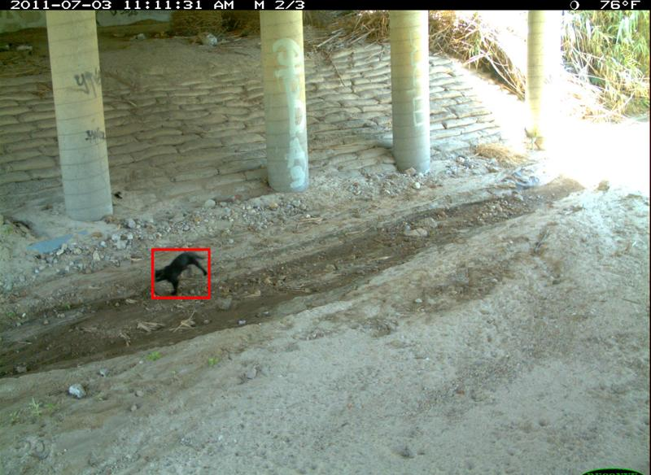
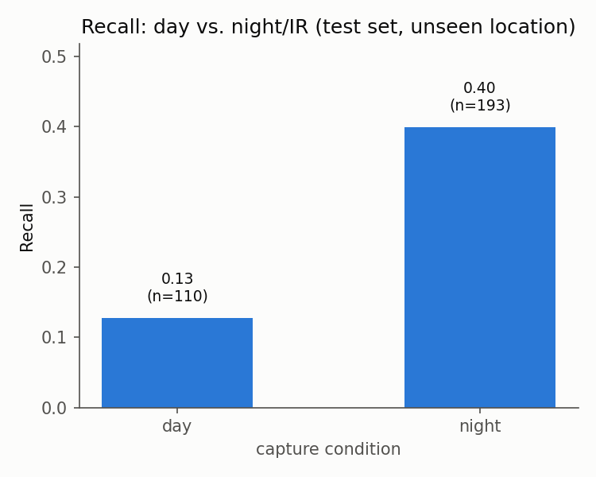

# Why your AI wildlife detector might not work at the next camera

Camera traps are everywhere in conservation work now. Motion-triggered cameras get strapped to trees across a reserve and left for months, quietly building up thousands of photos of whatever wanders past. The problem is that nobody has time to look through thousands of photos by hand, so researchers increasingly use AI models to sort through them automatically, flagging which photos actually contain an animal and what species it is.

I built one of these detectors for this project, trained it on photos from a couple of camera locations, and then asked a simple question nobody tends to put front and centre in these reports. What happens when you point the same model at a camera it has never seen before?

The short answer is that it gets noticeably worse. Not catastrophically. Just worse enough to matter if you were relying on these counts for actual conservation decisions.

## A bobcat mistaken for a coyote

One of the clearest examples of what goes wrong showed up in a single infrared night photo. A bobcat walks across frame, caught perfectly by the camera's motion trigger. The model finds the animal immediately and draws an almost pixel-perfect box around it. Then it labels it a coyote.

*Green box: the real bobcat. Red box: the model's guess, labelled "coyote."*

This matters because the training cameras barely had any bobcats in them (five photos, across all of training), while the new, unseen camera turned out to be a popular bobcat spot (over a hundred photos). The model never properly learned what a bobcat looks like, so when it saw one, it reached for the closest thing it did recognise. In black-and-white night-vision footage, where you are mostly looking at a silhouette rather than colour or fine fur detail, a bobcat and a coyote are not so different.

The lesson is a familiar one outside wildlife photography too. A model is only as good as the variety of examples it was trained on, and it will confidently guess wrong rather than admit it does not know.

## A cat that kept disappearing

A different animal, a domestic cat, showed up twice in the unseen camera's photos. Both times the model missed it completely. At first glance that looks like "the model is bad at cats," but looking at the actual photos tells a more specific story. Both cat sightings happened at the exact same spot under a bridge, a small dark shape against dark shadowed ground, barely visible even to a human eye scanning quickly. It was not a cat problem. It was a "small, dark animal in a dark corner of the frame" problem, and it would likely have missed a raccoon or an opossum in that same spot just as easily.

*Can you spot it without the red box? Neither could the model.*

## Night turned out easier than day

Here is the part that surprised me most. I expected the model to do worse at night, reasoning that infrared black-and-white photos give you less information than full colour daylight shots. The opposite happened. The model found noticeably more animals at night than during the day, even after controlling for how big the animal was in frame.

The best explanation, from actually looking through the photos rather than just the numbers, is that night photos are simpler. An animal lit by infrared flash against a dark background stands out sharply, almost like a spotlight. Daytime photos at these camera sites were often cluttered: dappled sunlight through leaves, patchy shadows, busy backgrounds, all of which can look animal-shaped to a model that has not seen very much daytime variety yet. Less visual noise, not more information, won out.

## Why this is worth saying out loud

None of this means the underlying idea is broken. It means that a single accuracy number from one camera tells you very little about how a model will behave somewhere new, and that the specific ways a model fails are usually more informative than the fact that it failed. A conservation team deploying one of these detectors at a new, unfamiliar site should expect some accuracy drop, and should budget for checking a sample of the new site's early results by hand rather than trusting the numbers blind from day one.

The code, the full numbers, and every figure referenced here are in this repository, including the parts that did not go as expected.
