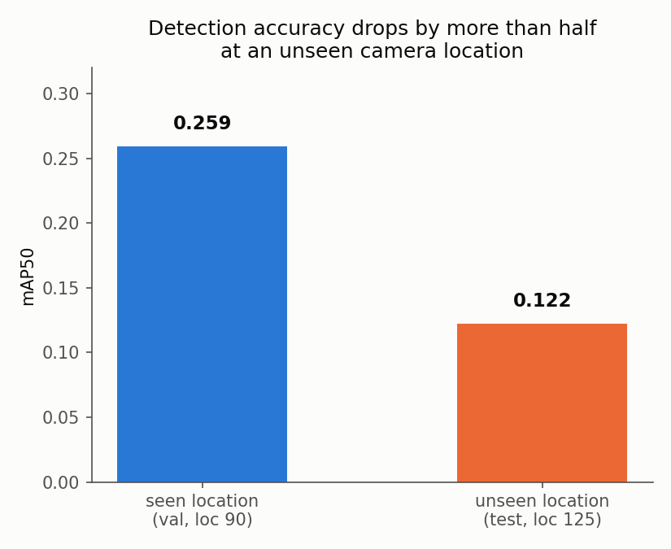

# Camera-trap wildlife detection and cross-site robustness

A YOLOv8 object detector fine-tuned on camera-trap images, with a focus on one question that most published benchmarks skip over. How well does a detector trained on a handful of camera locations actually perform at a camera it has never seen?

## Why this matters

Camera traps are one of the most widely used tools in wildlife conservation, and a single reserve or research project can run dozens of them across very different terrain, lighting, and vegetation. Retraining a detector for every new camera placement is rarely practical, so a model's ability to generalise to an unseen site is often more important in practice than its accuracy on the cameras it was trained on. Most published results report accuracy on data that looks like the training set. This project measures the gap deliberately, quantifies where it comes from, and treats it as the headline result rather than a footnote.

The underlying problem, a model trained in one visual environment deployed in a different one, also comes up directly in edge-device computer vision work outside conservation (for example waste-sorting systems that need to generalise across different facilities, lighting rigs, and camera placements).

## What this project demonstrates

- Fine-tuning a YOLOv8 object detector (Ultralytics) and evaluating it with standard detection metrics (precision, recall, mAP50, mAP50-95)
- A location-based data pipeline that explicitly prevents site leakage between train, validation, and test splits, with an automated check that raises if it is ever violated
- A class-agnostic detection matching metric written from scratch, used to make a zero-shot baseline measurable even when the pretrained model has no notion of the target classes
- Error analysis that goes beyond aggregate metrics, including a full confusion matrix and manual inspection of specific failure cases, used to correct an initial hypothesis that turned out to be incomplete
- Unit tests, linting (Ruff), and GitHub Actions CI, all of which run without needing the dataset or a trained model
- A CPU-only inference Dockerfile, with the model and image mounted at runtime rather than baked into the image
- ONNX export with CPU and GPU latency benchmarking, including a result (ONNX's speed advantage is hardware-dependent, not universal) that contradicts the common default assumption

## Headline result



Fine-tuned on only two camera locations, the model's mAP50 more than halves when evaluated at a third, previously unseen location (0.259 to 0.122). Precision drops even more sharply than recall, which suggests the model is partly keying on location-specific background cues rather than purely on animal appearance. Full breakdown, including which species and conditions drive the gap, is in [`results/step3_results.md`](results/step3_results.md).

| stage | precision | recall | mAP50 | mAP50-95 |
|---|---|---|---|---|
| zero-shot COCO baseline (class-agnostic) | 0.807 | 0.234 | n/a | n/a |
| fine-tuned, seen location (val) | 0.480 | 0.244 | 0.259 | 0.152 |
| fine-tuned, unseen location (test) | 0.188 | 0.187 | 0.122 | 0.065 |

See [`results/README.md`](results/README.md) for the full set of results, figures, and the per-step writeups.

## Project structure

```
src/data/        location-based data pooling, sequence sampling, train/val/test split
src/eval/        matching metrics (IoU, precision/recall) and condition classifiers (day/night, bbox size)
scripts/         data download, YOLO format conversion, evaluation, benchmarking, plotting
notebooks/       Colab notebook for GPU fine-tuning and benchmarking
tests/           unit tests, self-contained, no dataset dependency
results/         per-step findings, figures, and the full confusion matrix
models/          trained weights (gitignored, not committed)
data/            dataset (gitignored, see data/README.md for how to rebuild it)
```

## Reproducing this

Local setup:

```bash
python3.10 -m venv .venv
source .venv/bin/activate
pip install -r requirements.txt
```

Rebuild the small dataset subset (see [`data/README.md`](data/README.md) for licence and dataset details):

```bash
PYTHONPATH=. python scripts/download_subset.py
PYTHONPATH=. python scripts/build_manifest.py
PYTHONPATH=. python scripts/convert_to_yolo.py
```

Fine-tuning runs on Colab (free GPU tier): open [`notebooks/colab_finetune.ipynb`](notebooks/colab_finetune.ipynb) on GitHub via Colab and run it top to bottom.

Run the test suite:

```bash
PYTHONPATH=. pytest tests/ -v
```

Run inference in Docker:

```bash
docker build -t camera-trap-inference .
docker run --rm \
  -v "$(pwd)/models/<weights>.pt:/data/weights.pt:ro" \
  -v "$(pwd)/path/to/image.jpg:/data/image.jpg:ro" \
  camera-trap-inference --weights /data/weights.pt --image /data/image.jpg
```

## Limitations and failure modes

- **Small training set.** Fine-tuning used 602 images from only 2 camera locations. The seen-to-unseen accuracy gap could reflect a fundamental generalisation limit, or it could simply shrink with more training location diversity. This project cannot distinguish between those two explanations with the data it used.
- **Species composition varies by location.** The unseen test location is dominated by bobcat (135 instances) while the training locations had almost none (5 combined). Some of the per-class failures are really a training-data coverage problem rather than a detection problem.
- **No occlusion labels.** The dataset provides no occlusion annotation and no reliable automatic proxy was available, so occlusion was assessed only qualitatively during manual error inspection, not measured.
- **Small per-condition sample sizes.** Several breakdowns in Step 3 (night-time empty frames, individual rare species) have single-digit sample counts and should be read as illustrative rather than statistically robust.
- **The day/night finding has an unverified explanation.** Recall is higher at night than during the day, which holds up across size buckets, but the proposed explanation (IR images being higher-contrast than cluttered daytime backgrounds) is a hypothesis from visual inspection, not independently tested.
- **Export format choice should be re-checked on new hardware.** ONNX was faster than PyTorch on GPU but slower on CPU for this model. That result is specific to the hardware tested here and was not re-checked against other execution providers (for example ONNX Runtime's CoreML provider on Apple Silicon).
- **No stretch goals attempted.** Multi-object tracking and training a second model size for a fuller accuracy/speed/size comparison were both considered and deliberately left out to keep the project's scope matched to its actual research question.

## A note on AI assistance

This project was built working through each step with Claude Code as a pairing and mentoring tool, rather than as a code generator. I wrote the core logic myself where it mattered most for learning (the location-based data split and its leakage check, the IoU and detection-matching functions, the day/night and bounding-box condition classifiers), with each piece reviewed before moving on. Claude handled scaffolding, debugging, data verification, and drafting around that core logic, and the commit history reflects this collaboration through `Co-Authored-By` tags.
