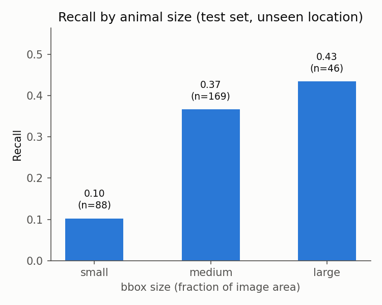

# Step 3 results: site-robustness breakdown

All numbers below are on the test set (location 125, unseen) using the fine-tuned
model from Step 2 (`models/cct20_yolov8n_best.pt`), at confidence threshold 0.25,
IoU 0.5 matching. Day/night classified from pixel color-channel difference
(`src/eval/conditions.py::classify_day_night`) - camera traps switch to IR
illumination at night, producing near-grayscale images. Size bucket is bbox area
as a fraction of image area (`bbox_size_category`), not COCO's fixed pixel
thresholds, since our images (2048x1494) are much larger than COCO's typical
~640x480.

## Recall by day vs. night/IR

| condition | recall | n |
|---|---|---|
| day | 0.127 | 110 |
| night | 0.399 | 193 |

**Counter to the naive expectation**, recall is substantially *higher* at night.
This holds even within each size bucket (see cross-tab below), so it isn't just
that night captures happen to have larger/closer animals.

| | small | medium | large |
|---|---|---|---|
| day | 0.077 | 0.143 | 0.182 |
| night | 0.122 | 0.458 | 0.667 |

**Working explanation (not yet independently verified beyond visual spot-checks):**
IR night images are high-contrast - a bright animal against a uniformly dark
background - while daytime images at these camera sites have cluttered, colorful
backgrounds (vegetation, dappled light, shadows) that a model fine-tuned on only
2 locations may not have learned to see past.

## Recall by animal size

| size bucket | recall | n |
|---|---|---|
| small (<1% of frame) | 0.102 | 88 |
| medium (1-5%) | 0.367 | 169 |
| large (>5%) | 0.435 | 46 |

Clear, expected pattern: smaller animals are much harder to detect. This is the
single strongest effect found in this breakdown.

## False positives on empty (no-animal) frames

| condition | mean FP/image | total FP | n images |
|---|---|---|---|
| day | 0.067 | 1 | 15 |
| night | 0.000 | 0 | 3 |

Sample size is too small (only 18 genuinely empty frames in this test set) to
draw a real conclusion here - noted as a limitation, not a finding.

## Manual error inspection

### `cat`: 0 precision/recall/mAP on both val and test (from Step 2)

Both `cat`-labeled frames at location 125 are the *same camera scene* (a bridge/
culvert), with the cat appearing as a small, dark silhouette against dark ground
in the same lower-left region of frame both times.

This reframes the Step 2 finding: it isn't "the model is bad at cats" in
general - it's that the only cat footage at this specific unseen camera happens
to be small, low-contrast, and camouflaged, consistent with the size-bucket
result above (small boxes: 0.10 recall). A different unseen camera might show
completely different cat performance.

### `coyote`: recall held up (0.58->0.46) but precision collapsed (0.41->0.08)

Checked the model's "coyote" predictions on the test set directly: 39 predicted
coyote boxes vs. only 13 real coyote instances. Sampling 9 of these predictions
against ground truth, 6 were actually **`bobcat`**, not coyote.

Localization is near-perfect (predicted and ground-truth boxes almost exactly
overlap) - the failure is purely the species label, not detection. Training
locations (51, 108) had only 5 bobcat instances combined, while location 125 is
bobcat-dominant (135 instances) - the model essentially never learned real
bobcat features and falls back to the closest class it does know (coyote),
especially likely under IR/night conditions where silhouette, not color/texture,
is most of the available signal.

## Key takeaways

1. The **seen vs. unseen location gap from Step 2 is not uniform** - it concentrates
   in small/distant animals and in species underrepresented in training, not
   evenly across all conditions.
2. The day/night result is counterintuitive and worth highlighting in the
   write-up precisely because it contradicts the naive assumption - but the
   causal explanation (background clutter vs. contrast) is a working hypothesis
   from visual inspection, not independently proven.
3. Two of the weakest per-class results from Step 2 (`cat`, `coyote`) turned out
   to have specific, identifiable causes (camouflage + tiny sample; class
   confusion with an underrepresented species) rather than being generically
   "hard" - this came only from looking at actual images, not from the metrics
   alone.

## Limitations

- Small sample sizes in several breakdowns (3 night-empty frames, 6 cat
  instances, 1 bird instance) - several numbers here are illustrative, not
  statistically robust.
- Occlusion was not analyzed quantitatively - CCT provides no occlusion label,
  and no reliable automatic proxy was available; would require manual labeling
  of a sample, out of scope for this pass.
- Day/night causal explanation is a hypothesis from a handful of visual
  spot-checks, not a controlled comparison.
